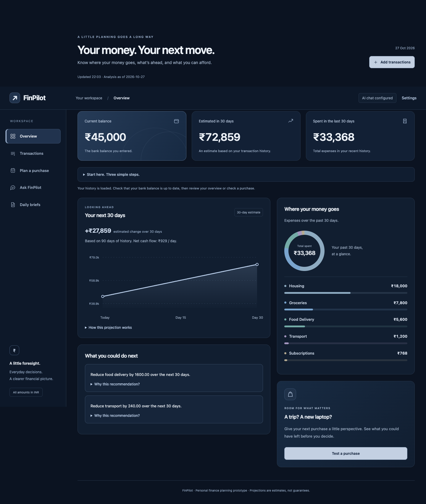
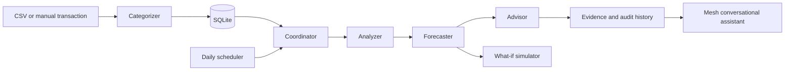

# FinPilot — a proactive personal finance assistant

FinPilot turns imported transactions into spending patterns, a 30-day cash-flow projection, evidence-linked actions, and purchase simulations. Its conversational assistant uses **Mesh API exclusively** for every LLM call.

Built for Agent Arena 2026. Target delivery: **23 October 2026**. This repository is a working single-user hackathon prototype, not a production banking service.



## Run locally

Use Python 3.11 or newer. From this repository's root:

```bash
python3 -m venv .venv
source .venv/bin/activate
pip install -r requirements.txt
cp .env.example .env
uvicorn app.main:app --reload --host 127.0.0.1 --port 8000
```

On Windows, activate with `.venv\Scripts\activate`.

Open **http://127.0.0.1:8000**. Select **Try sample data** in an empty database for a complete synthetic demo. The demo sets a ₹45,000 current balance. For your own data, import a CSV and enter today's actual bank balance separately. Importing transactions does not change that balance.

For live AI conversation, add your Mesh key to the local `.env`:

```dotenv
MESH_API_KEY=your_mesh_key_here
MESH_MODEL=openai/gpt-4o
```

The API endpoint is fixed in source to `https://api.meshapi.ai/v1`. No fallback to another AI provider exists. Missing credentials produce an explicit unavailable message; deterministic financial tools still work. The key stays on the backend. Do not paste secrets into the browser chat or commit `.env`.

Set MESH_MODEL to a model available to your Mesh account; the default is openai/gpt-4o. **Live check on 20 October 2026: Mesh returned HTTP 402 with spend_limit_exceeded; a successful completion remains unverified. The responsible account restriction has not been established; check with Mesh or the sponsor.**

## Tools used

| Purpose | Choice |
|---|---|
| Web/API server | FastAPI + Uvicorn |
| LLM access | OpenAI Python client, exclusively through Mesh API |
| Storage | SQLite |
| Scheduling | APScheduler, daily at 03:00 UTC / 08:30 IST by default |
| Interface | Responsive HTML, CSS, JavaScript; no frontend build step |
| Testing | pytest + FastAPI TestClient |
| Delivery | Docker and GitHub Actions |

`requirements.txt` contains direct dependency ranges. `requirements-lock.txt` captures the exact tested environment; use `pip install -r requirements-lock.txt` to reproduce it.

## How the agents cooperate



The four specialists have different deterministic tools and responsibilities. They are explicit Python components, not four differently named copies of one prompt:

1. **Categorizer:** merchant keywords and transaction direction assign categories; unmatched merchants remain `other`.
2. **Analyzer:** compares expenses in the latest 30 days with the preceding 30 days and detects increases of at least 20%.
3. **Forecaster:** projects average daily net cash flow over up to 90 days from a user-entered current balance.
4. **Advisor:** converts spending increases and negative projected balances into concrete actions, prioritized by potential saving. Each action contains its triggering evidence.

The coordinator assembles the output. The **Mesh conversational assistant** interprets these computed facts using a separate evidence-grounded prompt. The four financial specialists are rules/tools rather than LLM agents. This is a deliberate, testable baseline architecture; we do not claim LangGraph integration or autonomous bank access.

## Demo in three minutes

1. Start the app and select **Try sample data**.
2. Observe food delivery rising from ₹4,000 to ₹5,600: **40% higher**, with a **₹1,600 reduction target**.
3. Inspect the forecast, then simulate a ₹25,000 purchase while preserving a ₹10,000 reserve.
4. Increase the purchase to ₹100,000 to demonstrate an unfavorable scenario. Try additional monthly savings and compare the outcome.
5. Open **Why this recommendation?** to inspect the underlying comparison.
6. With a working Mesh key, ask: “What changed in my spending, and what should I focus on?”
7. Save a brief and inspect its persisted decision history. The real scheduler also saves a daily digest while the process is running.

## Input contract

CSV headers: `date,merchant,amount`. Dates use `YYYY-MM-DD`. Expenses are negative; inflows are positive. Values must be finite, and future transactions are rejected. Use one currency only: **INR**. The bundled CSV is synthetic and anchored to 18 October 2026; the demo button generates dates relative to the day it runs.

```csv
date,merchant,amount
2026-10-01,Salary,60000
2026-10-02,Apartment rent,-18000
2026-10-03,Zomato,-560
```

Imports are atomic: one invalid row rejects the entire file. Uploads are limited to 2 MB. Exact repeats of `(date, merchant, amount)` are skipped. This prevents accidental repeat imports but also collapses legitimate identical same-day purchases; use bank transaction IDs before expanding to real banking integrations. The transactions table shows the latest 500 rows; analysis uses the complete imported history within its time windows.

## Forecast and simulation assumptions

- Observation period: earliest imported date within the trailing 90 days through today, inclusive. Missing transaction days are treated as zero activity; input history must therefore be complete.
- Daily net cash flow = total signed cash flow / observation days.
- Projected balance = current balance + daily net × horizon days.
- Scenario balance = projected balance − one-time purchase + additional monthly savings × days / 30.
- “Affordable under model” means the **ending** scenario balance meets the entered reserve. It does not verify liquidity on every day before the purchase.
- Salary dates, recurring bill timing, inflation, interest, seasonality, and unknown future spending are not modeled. Less than 30 days of history is marked as limited history in the API.
- A spending increase is a comparison signal, not statistical proof of unusual behavior. Partial histories can distort the comparison.
- The app cannot establish whether a subscription is unused and never asserts that it is.

## Auditable decisions and scheduling

Dashboard reports and daily digests are stored in SQLite with UTC creation times, input transaction IDs, as-of dates, balances, forecast assumptions, and recommendation evidence. Successful AI answers are also saved alongside their question and financial context. The latest 30 snapshots are available through `/api/audit`; the UI shows five recent briefs.

APScheduler runs inside the web process. Run **one worker** to avoid duplicate schedules. The process must remain running at the configured hour; missed runs during downtime are not replayed. Delivery is to the **in-app history only**; email and Telegram delivery are not implemented.

## API

Interactive API documentation: `/docs`.

| Method | Route | Purpose |
|---|---|---|
| GET | `/health` | Health and whether a Mesh key is configured |
| GET | `/api/dashboard` | Generate and persist evidence-backed report |
| GET / POST | `/api/transactions` | List / manually log transactions |
| POST | `/api/import` | CSV multipart upload, field `file` |
| POST | `/api/balance` | Set current bank balance |
| POST | `/api/simulate` | Cost, days, reserve, monthly_saving |
| POST | `/api/chat` | Evidence-grounded question through Mesh |
| POST | `/api/demo` | Seed an empty database |
| POST | `/api/digest` | Persist an immediate brief |
| GET | `/api/audit` | Recent report snapshots |

Set `FINPILOT_TOKEN` before exposing the service beyond localhost. API requests then require `Authorization: Bearer <token>`. The interface accepts this token under **Connection settings** and stores it only in browser session storage. This is single-user protection, not multi-tenant authentication.

## Tests and honest self-evaluation

```bash
python -m pytest -q
python evaluation/run.py
```

Latest local result: **11 tests passed**. Tests cover full demo flow, atomic CSV import, duplicate detection, input validation, authentication, time-window boundaries, stale-history handling, simulation arithmetic, scheduler registration, and Mesh routing using a mock client. A dependency deprecation warning remains in FastAPI's TestClient/httpx integration; tests pass.

Measured synthetic evaluation, seed `20261018`:

| Metric | Result |
|---|---:|
| Categorization accuracy, 25 labeled cases | **80.0% (20/25)** |
| 30-day forecast mean absolute error, 30 holdout windows | **₹5,277.48** |
| Stable profile MAE | ₹0.00 |
| Variable-spending profile MAE | ₹897.17 |
| Unseen spending-shift profile MAE | ₹14,935.26 |

See [`evaluation/results.json`](evaluation/results.json) for every prediction and error, [`evaluation/categories.json`](evaluation/categories.json) for labels, and [`evaluation/run.py`](evaluation/run.py) for the reproducible experiment. Each forecast uses 90 training days and a separate 30-day holdout. These are small, developer-authored synthetic datasets, not an independent real-world benchmark. Unfamiliar merchants, positive refunds, and sudden behavior changes reveal known limitations. Live LLM quality is not included in these numbers.

## GitHub and hackathon submission

Public repository: **MaarreeJ/FinPilot_M**. This folder is standalone; publish its contents at the repository root, not the unrelated parent project.

Two workflows are included:

- `.github/workflows/tests.yml`: tests, compilation, reproducible evaluation.
- `.github/workflows/agent-arena-2026-checks.yml`: the official organizer workflow downloaded from the URL in the brief on 18 October 2026. It obtains a GitHub OIDC token, downloads the organizer's checker, and runs it with the required repository secrets.

In **Settings → Secrets and variables → Actions**, add:

- `MESH_API_KEY`: your working Mesh key.
- `SUBMISSION_TOKEN`: the token on your registered hackathon dashboard.

Push a commit after adding secrets, then inspect both workflows in **Actions**. Missing secrets will prevent organizer eligibility checks from passing. Local tests do not establish submission eligibility. Registration and final submission still happen through the organizer's dashboard.

## Deployment

```bash
docker build -t finpilot .
docker volume create finpilot-data
docker run --env-file .env -p 127.0.0.1:8000:8000 -v finpilot-data:/data finpilot
```

The container runs as a non-root user. For a public deployment, configure HTTPS at a reverse proxy, set a strong `FINPILOT_TOKEN`, use a persistent volume, and keep one worker. Docker configuration is supplied but has not been built in this environment.

Before handling multiple clients' financial data, add per-user authentication and authorization, isolated storage, rate limits, encrypted backups, retention/deletion controls, production monitoring, and security review. The current app is designed for a hackathon demonstration with synthetic data.

## Delivery plan to 23 October

- **18 October:** working app, deterministic agents, tests, evaluation, repository.
- **19 October:** configure Mesh and submission secrets; run a live end-to-end check.
- **20 October:** improve categorization with a separate held-out dataset; improve forecast timing.
- **21 October:** client demo and usability fixes; optionally add external digest delivery.
- **22 October:** final regression run, deployment if needed, record a short demo.
- **23 October:** verify organizer checks and submit the repository URL.

No open-source license is applied automatically; confirm the client's licensing preference before adding one.

## Resume the demo on 21 October

The local sample database `demo-rehearsal.db` is excluded from Git. Start from this project folder:

```bash
source .venv/bin/activate
FINPILOT_DB=demo-rehearsal.db uvicorn app.main:app --host 127.0.0.1 --port 8766
```

Open http://127.0.0.1:8766 in your browser. If this is a fresh clone and the database is empty, click **Try sample data** once. Otherwise keep the existing samples. Do not overwrite your `.env`.

Before recording, test the evidence view, purchase simulator, and saved brief. Live Mesh chat remains blocked by the provider's HTTP 402 response. Four organizer critical checks passed on the earlier published commit, but the organizer refused to record the result until an entry is submitted (HTTP 403). Neither result proves feature completeness.

Record the demo, upload it to YouTube, supply the required LinkedIn and X participation post links, then submit the organizer form and re-run its workflow. A deployed URL is optional in the current submission form. Stronger agents/anomaly detection, payment-timing forecasts, persisted simulations and external scheduled delivery remain pending; do not describe them as completed.
